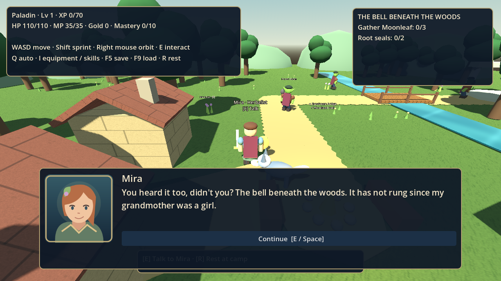
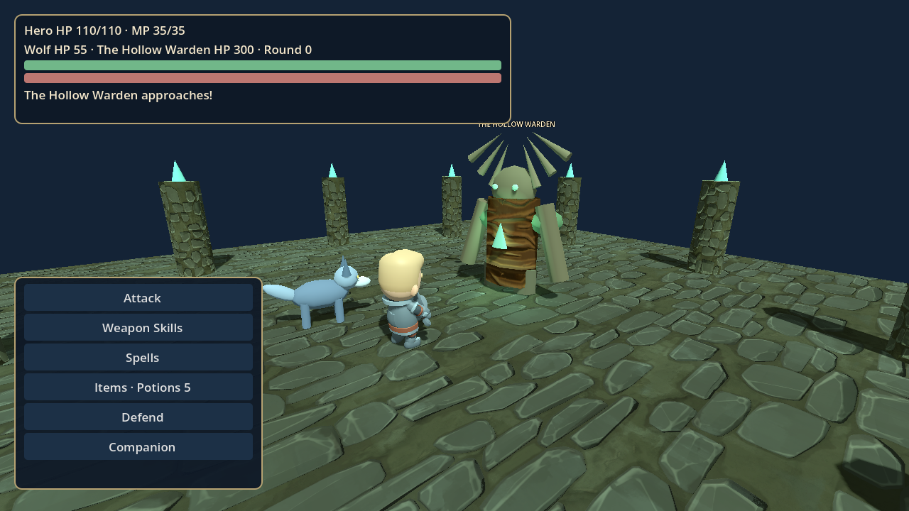

# Verdant Oath — The Bell Beneath the Woods

**Adventure milestone 0.3.1 · Godot 4.6+ · GDScript · Original assets**

A short, complete story arc: meet Mira in Willowbrook, gather Moonleaf along the woodland trail, cross Sunstream, descend into the Rootbound Sanctuary, and free the Hollow Warden. Fully turn-based battles share one deterministic simulator with the original goblin Auto-Battle system.

This is the first story milestone toward a polished 15-minute RPG demo. The quest has an ending, but the project is still a development build. Play length has not been measured with new players. Character models and animation are procedural, and the synthesized soundtrack is a demo score.





## Download and play on Windows

1. On GitHub choose **Code → Download ZIP**.
2. Right-click the ZIP in Downloads and choose **Extract All**. Use a new folder for this version.
3. In Godot's Project Manager choose **Import**, select the extracted `project.godot`, and choose **Import & Edit**.
4. Press **F5**, then choose **New adventure** to experience the story from the beginning.

New adventure backs up your previous save to `user://hero.backup.json` before resetting. **Continue adventure** uses your current save, including older versions. The project's internal application name intentionally remains unchanged to retain the old user-data directory. No paid assets, external services or plugins are needed.

## Controls

| Control | Action |
|---|---|
| WASD | Move relative to the camera |
| Shift | Sprint |
| Hold right mouse and move | Orbit camera |
| E | Talk, gather, examine, enter/leave the dungeon, or challenge a nearby enemy |
| E / Space / Enter during dialogue | Advance dialogue |
| Mouse | Select dialogue, battle and management buttons |
| Q in the forest | Goblin Auto-Battle, after ten normal goblin victories |
| Escape | Management/menu; resume by closing it |
| I in the forest | Equipment and class trees |
| R near the village campfire | Restore HP and MP |
| F5 | Save while exploring |
| F9 in the forest | Load |

Audio can be toggled from the title, forest management menu or dungeon pause menu. The setting persists separately from character saves. Closing the game window stops audio and exits.

## First adventure

- Talk to **Mira**, left of the village trail. Purple Moonleaf grows west of the trail, near the river, and beyond the bridge.
- Gather all three and return to Mira. She gives supplies, restores the party and prepares the charm that opens the shrine.
- Cross the bridge eastward. Examine the shrine to enter the sanctuary.
- Explore both side chambers. Defeat the Mosslings, then examine each **Root Seal** to cleanse it. Defeated guardians stay defeated in saved games.
- A pilgrim's cache on the northern corridor restores HP/MP and gives three potions, once.
- Face the guardian in the northern chamber. **When its branches coil, choose Defend next round.** Healing, potions and wolf behavior help manage the fight.
- After victory, speak to the guardian, leave the sanctuary at its southern entrance, and return to Mira for the ending. You can keep exploring afterward.

If defeated, retreat to Willowbrook and press R at the campfire. Defeat never completes a quest or awards victory rewards. Herbs, caches, discoveries and story rewards cannot be collected twice.

## Hotfix 0.3.1

Fixed a crash when using E to finish the shrine conversation and enter the dungeon. The dialogue now consumes keyboard input before its completion callback can remove the scene. The same fix covers Space/Enter at the boss intro and guardian's final conversation. Regression tests send real viewport input and verify the input is consumed before dialogue closes. Existing saves remain compatible; download the updated project into a new folder and choose Continue adventure.

## What changed in 0.3

- Start screen with Continue, New adventure, save backup and persistent audio setting.
- Data-defined story conversations, original portrait illustrations and dialogue that pauses player movement.
- Quest journal with objectives through the final conversation and adventure-complete panel.
- Separate stone dungeon with side chambers, persistent guardians, two root seals, a supply cache and an exit to the forest.
- Three enemy definitions: Forest Goblin, Briar Mossling and the Hollow Warden.
- Boss charge/telegraph mechanic, dedicated sanctuary battle arena, enemy-specific XP/gold/drop tables, and a Sunsteel Sword reward.
- Six original surface textures, water ripples, canopy wind, readable labels and corrected lighting.
- Procedural limb movement, idle breathing, attack lunges, hit/healing effects, action camera shots, health bars and victory animations.
- Three original synthesized music themes and five sound cues. No voice acting.
- Saved region and fractional exploration position, plus migration defaults for 0.1/0.2 saves.

## Existing RPG systems

Paladin primary with Ranger and Druid secondary classes; all six starting skills; HP/MP, XP, gold, levels, skill points and independent three-rank class trees. Each level grants three skill points. Class investments affect stats and rank three unlocks that class's mythic. Secondary mythic investments persist, but their abilities remain unavailable until the class becomes primary.

Eight independent equipment slots affect stats. Sword, shield and chest changes are visible. Equipment selection is still a free development toggle, not a finished inventory or shop. Wolf Attack, Support and Defend behaviors are automated each round. Six future companion roster slots and a separate postgame slot remain reserved; only the wolf is implemented. Wolf HP resets per encounter.

Ten **normal goblin victories** unlock goblin Auto-Battle. It never instantiates the 3D battle scene, uses the same combat rules and current stats/gear/companion, spends real HP/MP, can lose and rolls normal rewards. Its policy heals below half health, otherwise uses Sacred Strike if affordable, otherwise Attack. Auto wins and victories over other species do not advance normal goblin mastery. Auto-Battle is not available for the dungeon guardians or boss.

## Project layout

| Path | Responsibility |
|---|---|
| `scenes/title.tscn`, `scripts/title.gd` | Start screen and new-game confirmation |
| `scenes/world.tscn`, `scripts/world.gd` | Forest exploration, interactions, quests and management |
| `scripts/forest.gd` | Village, paths, river, bridge and movement boundaries |
| `scenes/dungeon.tscn`, `scripts/dungeon.gd` | Dungeon layout, guardians, seals, cache and boss gate |
| `scenes/battle.tscn`, `scripts/battle.gd` | Battle presentation, menus, animation and rewards |
| `scripts/combat.gd` | Deterministic, seeded, presentation-independent combat rules |
| `scripts/state.gd` | Hero state, derived stats, rewards, migration and saving |
| `scripts/dialogue.gd`, `data/dialogue.json` | Portrait dialogue and original story |
| `data/classes.json`, `data/enemies.json` | Modular class and enemy definitions |
| `scripts/art.gd`, `scripts/ui.gd` | Procedural models, shared materials and themed controls |
| `scripts/sound.gd`, `assets/` | Music, sound cues, portraits, textures and shaders |
| `tools/generate_assets.py` | Reproducible original asset generation |
| `tests/run.tscn` | Combat, persistence and full-story integration checks |

Assets and their provenance are described in [assets/README.md](assets/README.md). Changing class/enemy data can add definitions, but new effects, models or behavior still need corresponding implementations.

## Development and validation

```sh
godot --path . --editor
godot --headless --path . --editor --import --quit
godot --headless --path . --quit-after 90
# Use a separate data directory: these tests intentionally create and replace saves.
XDG_DATA_HOME=/tmp/verdant-oath-tests godot --headless --path . res://tests/run.tscn
```

All **60 checks passed with Godot 4.6.3**, covering seeded Auto/normal parity, possible defeat, MP legality, mythic restrictions, equipment stats, mastery, leveling, old-save defaults, fractional position persistence, reachable forest objectives, dialogue, unique rewards, actual dungeon/battle scene transitions, both guardians, seals, boss telegraph/defense, boss victory, return to Mira, ending persistence and defeat recovery. Tests accelerate game time and do not measure real play length. Audio playback is intentionally skipped in headless mode.

Rendered OpenGL captures were also generated and inspected for the title, village, dialogue, dungeon and boss battle. Reproduce them with a display available:

```sh
XDG_DATA_HOME=/tmp/verdant-capture godot --path . --audio-driver Dummy res://tools/capture.tscn -- /tmp/verdant-captures
```

This capture runner creates a temporary new character and visits scenes to take screenshots; keep its user-data directory separate from your normal save. Captures exercise rendering; Dummy audio does not validate speaker output. Music files were generated as valid PCM WAV, but listening and Windows input/performance playtesting remain user checks.

The cloud sandbox requires writable XDG directories:

```sh
mkdir -p /workspace/.runtime/{data,config,cache}
XDG_DATA_HOME=/workspace/.runtime/data XDG_CONFIG_HOME=/workspace/.runtime/config XDG_CACHE_HOME=/workspace/.runtime/cache godot --path /workspace/VID-GAME
```

Use the existing isolated checkout; an additional Git worktree is unnecessary.

## Current limits and next production work

The story is playable through its ending, but this is not the finished high-fidelity demo. Models are assembled from simple meshes with procedural animation; no production character rigs, facial animation, lip-sync, cutscene cinematography or professional voice acting are included. The original vector portraits and surface textures are modest placeholder-quality assets. There is one forest zone and one compact dungeon, with no village interiors. Explorable ground is flat; distant hills are scenery. Movement uses lightweight boundaries rather than full physics/navigation, and the camera can clip through scenery. The wolf can cut corners while following. Menus target a 1280×720 desktop layout. Only one save slot is supported, with a backup on new game; manually damaged saves are not fully recoverable.

The next production milestones are coherent authored character/environment assets and rigs, richer movement and attack animation, better camera collision and framing, a larger exploration route, inventory/economy balancing, and first-time-player feedback on pacing and difficulty. See [ROADMAP.md](ROADMAP.md).
