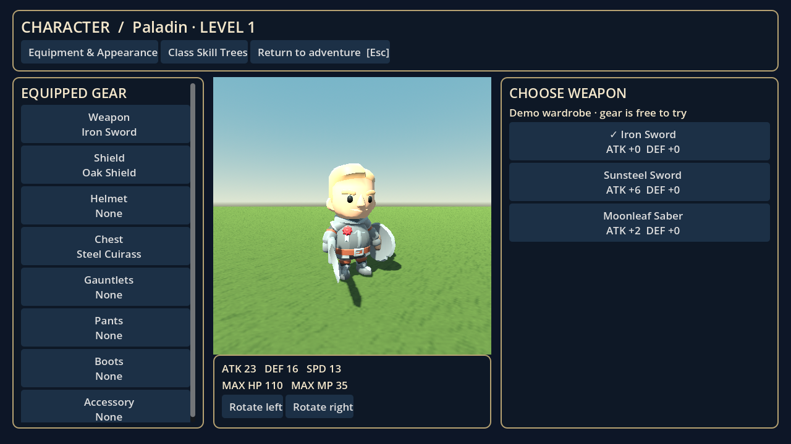
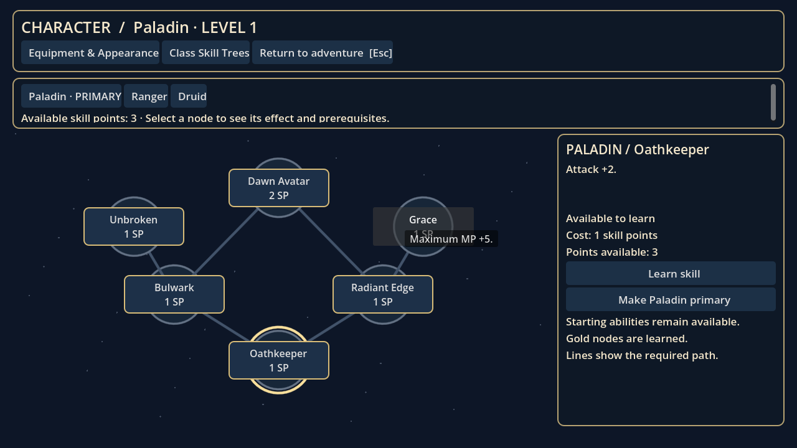

# Verdant Oath — The Bell Beneath the Woods

**Adventure milestone 0.5 · Godot 4.6+ · GDScript · Free CC0 art + original story/effects**

A short, complete story arc: meet Mira in Willowbrook, gather Moonleaf along the woodland trail, cross Sunstream, descend into the Rootbound Sanctuary, and free the Hollow Warden. Fully turn-based battles share one deterministic simulator with the original goblin Auto-Battle system.

This is the first story milestone toward a polished 15-minute RPG demo. The quest has an ending, but the project is still a development build. Play length has not been measured with new players. The hero now uses licensed rigged character art with skeletal animation. Enemies and foliage still include procedural models, and the synthesized soundtrack is a demo score.






## Download and play on Windows

1. On GitHub choose **Code → Download ZIP**.
2. Right-click the ZIP in Downloads and choose **Extract All**. Use a new folder for this version.
3. In Godot's Project Manager choose **Import**, select the extracted `project.godot`, and choose **Import & Edit**.
4. Press **F5**, then choose **New adventure** to experience the story from the beginning.

New adventure backs up your previous save to `user://hero.backup.json` before resetting. **Continue adventure** uses your current save, including older versions. The project's internal application name intentionally remains unchanged to retain the old user-data directory. No paid assets, external services or plugins are needed.

## Controls

| Control | Action |
|---|---|
| WASD | Move relative to the camera |
| Shift | Sprint |
| Hold right mouse and move | Orbit camera |
| E | Talk, gather, examine, enter/leave the dungeon, or challenge a nearby enemy |
| E / Space / Enter during dialogue | Advance dialogue |
| Mouse | Select dialogue, battle and management buttons |
| Q in the forest | Goblin Auto-Battle, after ten normal goblin victories |
| Escape | Management/menu; resume by closing it |
| I while exploring | Equipment and appearance page |
| K while exploring | Dedicated class skill-tree page |
| R near the village campfire | Restore HP and MP |
| F5 | Save while exploring |
| F9 in the forest | Load |

Audio can be toggled from the title, forest management menu or dungeon pause menu. The setting persists separately from character saves. Closing the game window stops audio and exits.

## First adventure

- Talk to **Mira**, left of the village trail. Purple Moonleaf grows west of the trail, near the river, and beyond the bridge.
- Gather all three and return to Mira. She gives supplies, restores the party and prepares the charm that opens the shrine.
- Cross the bridge eastward. Examine the shrine to enter the sanctuary.
- Explore both side chambers. Defeat the Mosslings, then examine each **Root Seal** to cleanse it. Defeated guardians stay defeated in saved games.
- A pilgrim's cache on the northern corridor restores HP/MP and gives three potions, once.
- Face the guardian in the northern chamber. **When its branches coil, choose Defend next round.** Healing, potions and wolf behavior help manage the fight.
- After victory, speak to the guardian, leave the sanctuary at its southern entrance, and return to Mira for the ending. You can keep exploring afterward.

If defeated, retreat to Willowbrook and press R at the campfire. Defeat never completes a quest or awards victory rewards. Herbs, caches, discoveries and story rewards cannot be collected twice.

## New in 0.5 — Project Mythic foundation

The [technical audit and prioritized plan](docs/PROJECT_MYTHIC_AUDIT.md) maps the existing game against the [complete design brief](docs/design/PROJECT_MYTHIC_V1.md). This milestone preserves the current story, quest layout, class balance and combat calculations.

- Shared substepped movement prevents crossing narrow barriers during long frames.
- Shared orbit camera sweeps against camera-only cottage, tree and sanctuary-wall blockers, pulling inward immediately and easing back out.
- **Settings** is available from the title, forest/dungeon menus and idle battle screen. It includes 1×/1.75×/2.5× battle speed, minimal battle animations, reduced battle camera movement, mouse sensitivity, music/effect volumes and mute. Settings persist independently of your character. Exploration input and battle actions are blocked while settings are open.
- Saves retain the existing flat hero format and slot, with schema version 1 metadata, validated temporary writes, a `.previous` recovery copy and an original `.v0.backup` when loading an unversioned save. A newer incompatible save is preserved and blocked from implicit overwrite. The title explains recovery or unreadable saves. New adventure still explicitly backs up your old slot.
- Reusable implementation lives in `exploration_motion.gd`, `exploration_camera.gd`, `camera_obstacles.gd`, `user_settings.gd`, `options_panel.gd` and `save_store.gd`. Integration changes affect world/dungeon, title, battle presentation, hero animation, sound and State; quest/dialogue/content data remain intact.

Next: stable ability IDs and data-driven spellbooks/status effects, followed by class chemistry, companion progression and owned equipment. The full design brief is a roadmap, not a claim that all planned systems exist.

## New in 0.4 — art, animation and character pages

- **Designed rigged characters:** KayKit's CC0 Knight, Rogue and Mage outfits replace the assembled hero. Plate, leather and robe choices change the full silhouette. The village NPC also uses a rigged model.
- **Free textured environment kit:** selected Quaternius Medieval Village components build cottages with dimensional roofing, shutters, frames, doors, vines and chimneys. Painted stone, wood, plaster and roof textures include normal/roughness maps. All are bundled with CC0 license/provenance records.
- **Distinct action animations:** default attack uses a thrust; Sword Slash a diagonal cut; Shield Bash a shield strike; Sacred Strike an overhead chop/holy column; Hunter's Mark a point-and-shoot/target sigil; Thornbind a raised casting/root spiral; Regrowth a longer healing cast/petal bloom. Each mythic uses its own clip and effect. Wolf/enemy moves have separate procedural choreography. The hero also walks, runs, blocks, reacts to hits, celebrates and falls on defeat using skeletal clips.
- **Equipment & Appearance page:** press I. Select a slot on the left, compare candidate stats on the right, and inspect the live rotating 3D preview in the middle. Equipment attaches to animated hand/body sockets and persists. Plate/leather/robe are full outfit variants; other armor pieces add independent overlays to the base outfit.
- **Class Skill Trees page:** press K or select its tab. Choose Paladin/Ranger/Druid, select a connected node, read its effect/prerequisites/cost, then press Learn. Each class has six nodes. Normal nodes cost one point; mythics cost two and require both branches. Learned nodes are gold. Starting abilities remain available.
- **Save migration:** old class ranks convert to learned nodes without spending points again. Previously unlocked mythics remain unlocked, with their prerequisites included. Only the primary class's mythic can be used. Old generic leather gear converts to visible slot-specific gear.

The wardrobe is still a free demo selection; there is no shop or inventory ownership system. The imported art is stylized and optimized for games. Remaining procedural enemies/foliage and camera collision are future art/game-feel work.

## Hotfix 0.3.1

Fixed a crash when using E to finish the shrine conversation and enter the dungeon. The dialogue now consumes keyboard input before its completion callback can remove the scene. The same fix covers Space/Enter at the boss intro and guardian's final conversation. Regression tests send real viewport input and verify the input is consumed before dialogue closes. Existing saves remain compatible; download the updated project into a new folder and choose Continue adventure.

## What changed in 0.3

- Start screen with Continue, New adventure, save backup and persistent audio setting.
- Data-defined story conversations, original portrait illustrations and dialogue that pauses player movement.
- Quest journal with objectives through the final conversation and adventure-complete panel.
- Separate stone dungeon with side chambers, persistent guardians, two root seals, a supply cache and an exit to the forest.
- Three enemy definitions: Forest Goblin, Briar Mossling and the Hollow Warden.
- Boss charge/telegraph mechanic, dedicated sanctuary battle arena, enemy-specific XP/gold/drop tables, and a Sunsteel Sword reward.
- Six original surface textures, water ripples, canopy wind, readable labels and corrected lighting.
- Procedural limb movement, idle breathing, attack lunges, hit/healing effects, action camera shots, health bars and victory animations.
- Three original synthesized music themes and five sound cues. No voice acting.
- Saved region and fractional exploration position, plus migration defaults for 0.1/0.2 saves.

## Existing RPG systems

Paladin primary with Ranger and Druid secondary classes; all six starting skills; HP/MP, XP, gold, levels, skill points and independent six-node branching class trees. Each level grants three skill points. Nodes give the stat bonuses shown in their descriptions, including wolf damage and healing bonuses. Mythics require both central branches and two additional points. Secondary mythics stay saved and remain unavailable until their class becomes primary.

Eight independent equipment slots affect stats and appearance. Use the wardrobe page to select textured weapons/shields and full plate, leather or robe outfits, plus independent helmet, glove, leg, boot and accessory overlays. Equipment selection is a free demo wardrobe rather than a finished inventory or shop. Wolf Attack, Support and Defend behaviors are automated each round. Six future companion roster slots and a separate postgame slot remain reserved; only the wolf is implemented. Wolf HP resets per encounter.

Ten **normal goblin victories** unlock goblin Auto-Battle. It never instantiates the 3D battle scene, uses the same combat rules and current stats/gear/companion, spends real HP/MP, can lose and rolls normal rewards. Its policy heals below half health, otherwise uses Sacred Strike if affordable, otherwise Attack. Auto wins and victories over other species do not advance normal goblin mastery. Auto-Battle is not available for the dungeon guardians or boss.

## Project layout

| Path | Responsibility |
|---|---|
| `scenes/title.tscn`, `scripts/title.gd` | Start screen and new-game confirmation |
| `scenes/world.tscn`, `scripts/world.gd` | Forest exploration, interactions, quests and management |
| `scripts/forest.gd` | Village, paths, river, bridge and movement boundaries |
| `scenes/dungeon.tscn`, `scripts/dungeon.gd` | Dungeon layout, guardians, seals, cache and boss gate |
| `scenes/battle.tscn`, `scripts/battle.gd` | Battle presentation, menus, animation and rewards |
| `scripts/combat.gd` | Deterministic, seeded, presentation-independent combat rules |
| `scripts/state.gd` | Hero state, derived stats, rewards, migration and saving |
| `scripts/dialogue.gd`, `data/dialogue.json` | Portrait dialogue and original story |
| `data/classes.json`, `data/enemies.json` | Modular class and enemy definitions |
| `scripts/art.gd`, `scripts/ui.gd` | Shared materials, remaining procedural models and themed controls |
| `scripts/hero_visual.gd`, `scripts/battle_motion.gd` | Imported skeleton/outfit/gear integration and per-action animation/VFX choreography |
| `scripts/character_menu.gd`, `scripts/skill_graph.gd` | Dedicated wardrobe and connected skill-tree pages |
| `scripts/village_art.gd` | CC0 modular cottage assemblies |
| `data/equipment.json` | Slot-specific wardrobe definitions and stats |
| `scripts/sound.gd`, `assets/` | Music, sound cues, portraits, textures and shaders |
| `tools/generate_assets.py` | Reproducible original asset generation |
| `tests/run.tscn` | Combat, persistence and full-story integration checks |

Assets and their provenance are described in [assets/README.md](assets/README.md). Changing class/enemy data can add definitions, but new effects, models or behavior still need corresponding implementations.

## Development and validation

```sh
godot --path . --editor
godot --headless --path . --editor --import --quit
godot --headless --path . --quit-after 90
# Use a separate data directory: these tests intentionally create and replace saves.
XDG_DATA_HOME=/tmp/verdant-oath-tests godot --headless --path . res://tests/run.tscn
XDG_DATA_HOME=/tmp/verdant-presentation-tests godot --headless --path . res://tests/presentation.tscn
```

The reliability suite adds **19 checks** for camera collision, long-frame movement, save corruption/recovery/version protection, setting persistence, modal input and presentation/simulation parity. Run it with `godot --headless --path . res://tests/reliability.tscn` using another isolated data directory.

The full-game suite has **60 checks** and the new presentation/character suite has **61 checks**, all passing with Godot 4.6.3, covering seeded Auto/normal parity, possible defeat, MP legality, mythic restrictions, equipment stats, mastery, leveling, old-save defaults, fractional position persistence, reachable forest objectives, dialogue, unique rewards, actual dungeon/battle scene transitions, both guardians, seals, boss telegraph/defense, boss victory, return to Mira, ending persistence and defeat recovery. The presentation suite also verifies all eight slots, visible attachments, outfit swaps, distinct imported action clips, real clip playback, running, skill prerequisites/costs, legacy skill/gear migration, UI investment, wardrobe preview updates and effect cleanup. Tests accelerate game time and do not measure real play length. Audio playback is intentionally skipped in headless mode.

Rendered OpenGL captures were also generated and inspected for the title, village, dialogue, equipment, skills, dungeon, boss and a combat action. Reproduce them with a display available:

```sh
XDG_DATA_HOME=/tmp/verdant-capture godot --path . --audio-driver Dummy res://tools/capture.tscn -- /tmp/verdant-captures
```

This capture runner creates a temporary new character and visits scenes to take screenshots; keep its user-data directory separate from your normal save. Captures exercise rendering; Dummy audio does not validate speaker output. Music files were generated as valid PCM WAV, but listening and Windows input/performance playtesting remain user checks.

The cloud sandbox requires writable XDG directories:

```sh
mkdir -p /workspace/.runtime/{data,config,cache}
XDG_DATA_HOME=/workspace/.runtime/data XDG_CONFIG_HOME=/workspace/.runtime/config XDG_CACHE_HOME=/workspace/.runtime/cache godot --path /workspace/VID-GAME
```

Use the existing isolated checkout; an additional Git worktree is unnecessary.

## Current limits and next production work

The story is playable through its ending, but the art pass is ongoing. The hero and Mira use CC0 KayKit character art with skeletal animation, and the cottages/materials use Quaternius's CC0 kit. Goblins, the wolf, Mosslings, the Warden and foliage still use simpler original geometry. Additional equipment overlays are basic prototype meshes. There is no facial animation, lip-sync or voice acting. Music is synthesized. There is one forest and one compact dungeon, with no village interiors. Explorable ground is flat; distant hills are scenery. Movement uses lightweight boundaries rather than full physics/navigation, and camera blockers are conservative approximations; close walls can pull the camera very near the hero. The wolf can cut corners while following. Menus target a 1280×720 desktop layout. Only one save slot is supported. Recovery restores the previous valid save when available; it cannot reconstruct progress lost from both damaged copies.

Further work: bring remaining enemies/foliage to the character art's quality level, improve camera collision, create a real inventory/reward economy, and playtest pacing, balance and performance on Windows. See [ROADMAP.md](ROADMAP.md).
