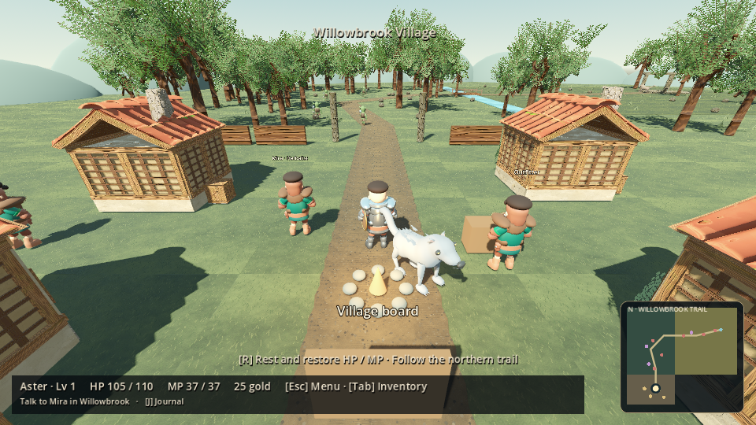

# Verdant Oath — The Bell Beneath the Woods

**Demo 0.8.0 · Godot 4.6+ · GDScript · Original art and credited CC0 assets**

A short, fully turn-based 3D RPG: create a three-class hero, buy your first weapon in Willowbrook, journey through Whisperwood and Sunmeadow Plains, solve the sanctuary's puzzles and restore its guardian. The main story targets 15–20 minutes; optional errands, mastery and the postgame challenge extend it. This target has not been established by a timed human playtest.



[Equipment preview](docs/screenshots/0_8_equipment.png) · [Companion art preview](docs/screenshots/0_8_companion.png)

## Launch

1. Download **Code → Download ZIP** from this repository and extract into a new folder.
2. In Godot 4.6 or newer, **Import** the extracted `project.godot`, then **Import & Edit**.
3. Let the models import, then press **F5** to run from the title screen.
4. **New adventure** includes class creation and the unequipped opening. **Continue adventure** preserves your current character. A new adventure backs up your previous save.

Godot is the only runtime dependency. No account, external API, paid asset or plugin is required. The application name remains unchanged so existing saves are found.

## Controls

| Input | Action |
|---|---|
| WASD / Shift | Move / sprint |
| Hold right mouse + move | Orbit camera |
| Touch an enemy | Start an encounter; mastered species offer a mode choice first |
| E | Talk, gather, shop, read puzzles, cleanse seals and enter/leave the shrine |
| Tab | Inventory: healing potions, MP ether and companion rations |
| Escape | Pause menu / close page or modal |
| I / K / C / J | Equipment / class trees / companion / journal |
| R near camp | Restore hero HP/MP and companion HP, including after defeat |
| F5 / F9 outdoors | Save / load; editor F5 launches the game |
| E / Space / Enter | Advance dialogue |
| Mouse / Tab + Enter | Menu controls; scroll longer panels |

Exploration has a compact bottom status strip, contextual interaction prompt and bottom-right minimap. Purple dots mark Moonleaf, red dots mark roaming monsters, gold marks town services and blue marks shrine/active skyglass objectives. Quest details and controls live in the journal and pause menu. Settings include battle speed, minimal animations, camera motion/sensitivity and audio levels.

## Character and equipment

All twelve classes are selectable, with distinct six-stat baselines and growth. Your character receives **60% primary + 20% secondary 1 + 20% secondary 2** for HP, MP, attack, defense, agility and dexterity, rounded once after combining base and growth at the current level. Creation previews the current combination at levels 1 and 10. Secondary order does not change stats; primary designation does. **All three classes and their roles stay locked for this demo.** Reassignment belongs to a later chapter.

Weapon proficiencies are the union of all three classes. Plate armor still requires a Warrior or Paladin primary. Only the primary class's learned mythic is usable. Each class and each of thirteen weapon families has a separate twelve-node, fifty-point tree, with the capstone gated at level 50. Earn two shared skill points per level; class/weapon mastery and prerequisite paths also gate progress.

Begin with no equipment, 120 gold, three potions, one ether and one companion ration. Buy a compatible weapon at the outfitter east of camp. **Owning a weapon unlocks combat; speaking to Mira and buying armor are optional.** The shop equips purchases automatically and protects only the cheapest compatible first weapon's price from optional spending.

Eight independent slots are owned permanently. Every shop item, including armor, accessories and supplies, has a rotating model preview on hover or keyboard focus. Inspecting an item never purchases or equips it. Gear changes update stats and visible equipment.

**Greatswords, axes, spears, bows, staves, claws, scythes and warhammers use both hands.** Equipping one stows your shield without deleting it. Shield equipment and shield abilities stay unavailable until you switch back to a one-handed weapon. Their attack, agility, dexterity, HP or MP bonuses compensate for that tradeoff. These values remain subject to playtesting.

## Adventure and side quests

Speak to Mira for the Moonleaf quest. Take the north road through Whisperwood, cross Sunstream at the bridge and continue through Sunmeadow Plains to the shrine. Defeat the three Moonleaf guards, gather their plants and return to Mira before entering the sanctuary. The expanded outdoor footprint is roughly three times the previous area, with a distinct village and a longer winding route.

Town errands can be accepted independently:

| Villager | Request | Reward |
|---|---|---|
| Captain Rowan, southwest of camp | Defeat four Forest Goblins | 55 gold + 65 XP |
| Artisan Nessa, southeast | Collect three skyglass clusters in the plains | 60 gold + 70 XP |
| Keeper Oren, west | Defeat both sanctuary Mosslings | 45 gold + 55 XP |

Return to the giver to claim each reward once. Earlier collected materials and victories count. Dexterity can add bonus gold to these rewards. Progress is saved and shown in the journal.

Below the shrine, defeat the two chamber guardians and solve their inscriptions: align the western symbol dials and play the eastern bell sequence. Wrong bell notes reset only that sequence. Cleansing both solved seals opens the guardian corridor. The pilgrim's cache restores your party and supplies potions. **Defend** when the Hollow Warden charges. Return its living ember to Mira to finish the story and choose a permanent companion.

## Battles and companions

Combat remains fully turn based: Attack, Weapon Skills, Spells, Items, Defend and Companion. Agility determines initiative. Seeded dexterity checks determine dodges and bonus gold. Spells use MP; status effects, regeneration, marks, roots, stuns, bleed and shield chemistry remain functional. Visuals are separate from the deterministic simulator.

Enemies patrol and nearby outdoor enemies approach the hero. Contact starts combat without pressing E. **Ten normal victories for that species** unlock a choice between normal combat and Auto-Battle on contact. The preview shows a current-state forecast and an estimated win rate from 24 simulated seeds; this estimate is not a guarantee. Previewing consumes nothing. Auto resolves in exploration with the same simulator, spends HP/MP/potions/companion HP, can lose, and grants normal XP/gold/drop rolls only on victory. Auto wins do not increase normal mastery. The Warden must be fought normally. Cancel/return gives a brief contact grace period. Defeat returns you to camp for recovery.

The wolf is a temporary loan. After the main quest, preview and permanently choose Dire Wolf, Griffin, Dragon, Warhorse, Spirit Fox or Golem. One companion is active, using automated Attack/Support/Defend behavior, persistent HP, XP and training branches. Every permanent choice grants the same travel-speed bonus. The optional village-board Warden echo unlocks a second and final permanent bond.

## Saves

Schema 4 uses `user://hero.json`, a validated temporary write and a `.previous` recovery copy. It stores classes/roles, skills/mastery, equipment, consumables, side quests, partial puzzles, story/position, companion records, monster mastery and gold. Earlier schema files receive a versioned backup. Starting over creates `hero.backup.json`. Unreadable unrecoverable or newer-schema saves are preserved rather than silently overwritten.

Existing saves retain their chosen classes and progress, with stats recalculated under the blend and incompatible two-handed/shield pairs normalized by stowing the shield. Old outdoor positions move safely to town because the map changed. Already restored guardians remain restored. A new adventure is recommended to experience the complete revised opening, but is not required to load your character.

## Development and validation

Import before testing:

```bash
godot --headless --path . --editor --import --quit
```

Tests create/replace saves; isolate each run from your personal data:

```bash
for suite in run presentation reliability demo progression layout shop_flow adventure8; do
  XDG_DATA_HOME=/tmp/verdant-test-$suite godot --headless --path . res://tests/$suite.tscn
done
```

The suites cover deterministic combat, the actual creation-to-ending/postgame flow, all twelve starts and 1,320 class permutations, equipment/hand rules, healing, side rewards, contact/Auto-Battle choices, partial puzzle saves and layout. Tests accelerate time and teleport; they do not establish human playtime or final visual quality. See [the 0.8 report](docs/DEMO_0_8.md) for final results and limitations.

With a display, capture the new areas, models, previews and puzzles at a separate save location:

```bash
XDG_DATA_HOME=/tmp/verdant-review godot --path . --rendering-method gl_compatibility --audio-driver Dummy res://tools/review_capture.tscn -- /tmp/verdant-review-images
```

Combat lives in `combat.gd`, data/rules in `data/` and `game_rules.gd`, persistence/economy in `state.gd`/`save_store.gd`, and presentation in the battle, character and world scripts. Original model/texture build scripts are included under `tools/`; no asset generation is needed to play. See [asset credits](assets/README.md), [the master overview](docs/design/PROJECT_MYTHIC_V1.md) and [roadmap](ROADMAP.md).

## Known limits

This is an expanded playable demo, not a finished commercial release. The art pass replaces primitive companions/enemies/weapons and adds armor detail, taller hero proportions, cutout foliage and material maps, but remains stylized and procedurally authored. Hero motion uses the credited CC0 rig; companions use simpler segmented animation. Terrain is mostly flat, followers can cut corners, armor may clip in some poses, and portraits do not match customization dynamically.

A timed Windows playtest, audio listening, deeper balance/accessibility review and controller support remain outstanding. There is no level-50 campaign, mounted/flight traversal, crafting/selling, multi-enemy battle system, voice acting or full-game postgame campaign. Desktop UI uses a 1280×720 logical canvas with scaling and scrollable overflow.
