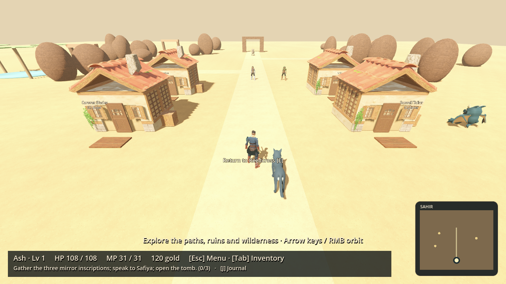
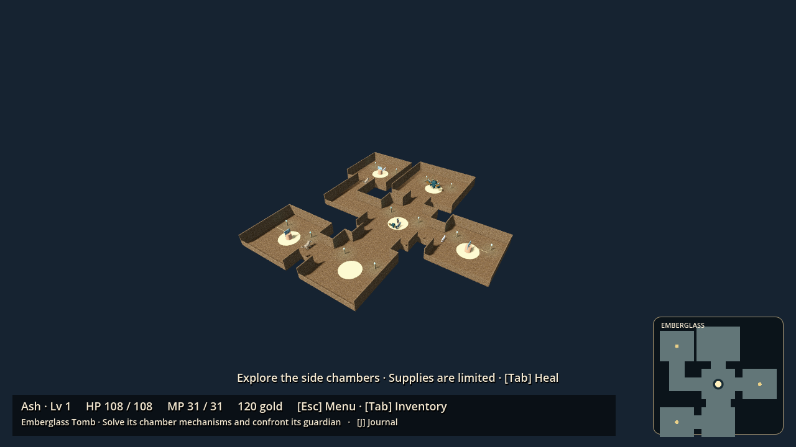
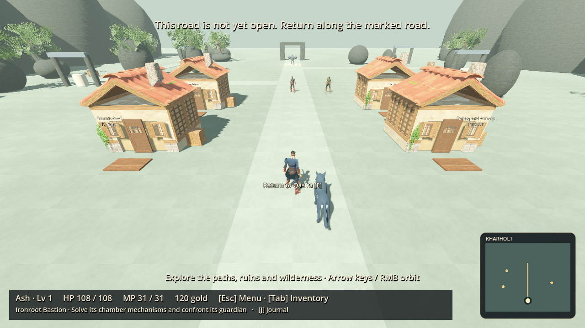
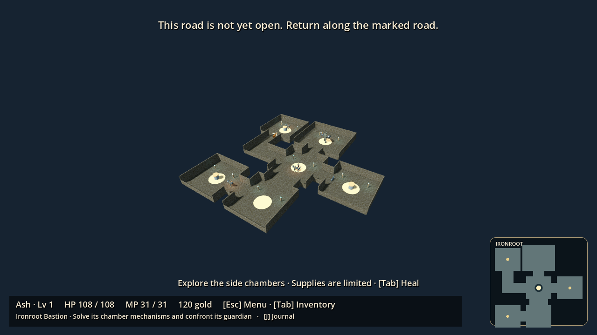
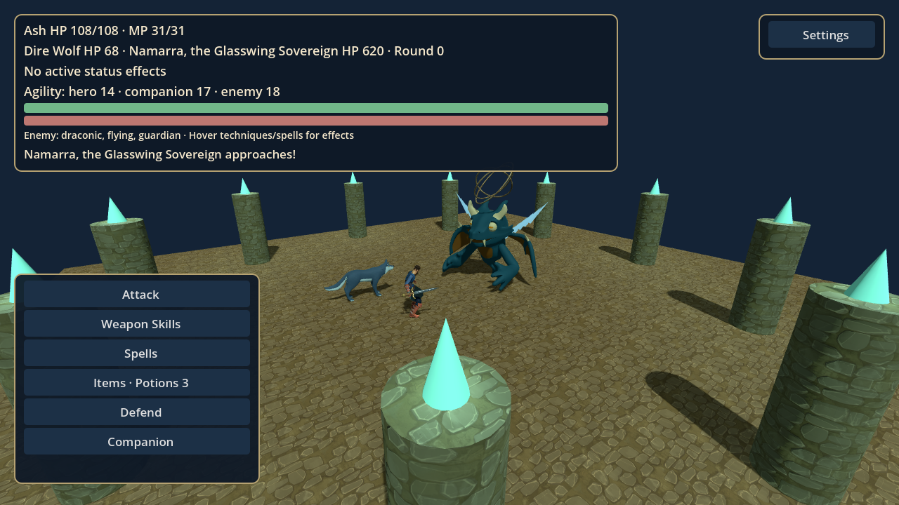
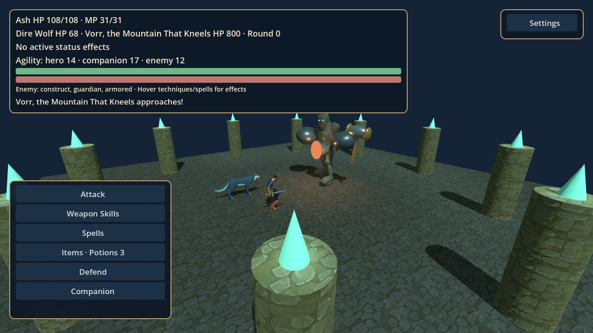

# Four-region campaign alpha

This branch extends the existing game; it preserves all twelve selectable classes, one primary/two secondary roles, male/female creation, equipment restrictions, weapon stances, companions, mastery and the existing save location. It adds playable Sahir and Kharholt regions and revises the earlier dungeons and learned abilities.

## Start or continue

Extract the GitHub ZIP into a new permanent folder, import its `project.godot` in Godot 4.6+, wait for import and press **F5**. Use **Continue adventure** for your current save. Do not rename the project in Project Settings: its existing application name intentionally preserves the Godot user-data folder.

The old 15–20 minute opening remains the first chapter; the expanded four-region campaign is longer and has not been timed in a human playtest. This is a playable alpha, not a finished full-game release.

## Route through chapters 3 and 4

1. Complete Willowbrook and the Reliquary. **Report to Iona** after restoring the Drowned Keeper, including on an older completed save.
2. In Reedcross, go east of the square to the **Sahir caravan road** sign (world position 16, -16), then press **E**.
3. In **Qasira**, speak with **Archivist Safiya**. Investigate the oasis, caravan wreck and observatory inscriptions in any order. Optional side paths contain treasure and a repeatable set of normal enemy encounters; the scout pays a bounty once for three Sandglass Drakes.
4. Return to Safiya, then enter the **Emberglass Tomb**. Explore its six rooms and optional vaults. Rotate the dawn mirror east, dusk west and moon south; the beams visibly follow their settings. Confront **Namarra, the Glasswing Sovereign**, and defend when Glassfall is telegraphed.
5. Return to the wilderness and use the **northeastern Kharholt Pass** (36, -43). It opens when Namarra is restored.
6. At **Kharholt Forge**, meet **Brann**, recover the three forge songs and return. The local miner offers a once-only bounty for three Ironfang Hounds.
7. In **Ironroot Bastion**, defeat the western and eastern chamber watchers. Cool the west anvil, then vent the east pressure. Side rooms hold optional treasure and encounters. Confront **Vorr, the Mountain That Kneels**, and defend against Mountainfall.
8. Speak with the restored guardian and return to Brann. You can continue exploring or travel back through earlier regions. Regions 5–12 remain planning records.

Regional gear, a healthy companion and supplies matter. Automated balance smoke tests use level 8 for Sahir and level 12 for Kharholt, six potions, regional clothing/weaponry and an active dire wolf. These are preparation examples, not level locks or a guarantee for every build/seed. Spend your shared skill points to specialize; you do not receive a completed tree.

Each new town has front-facing, enterable weapon, armor, item and inn buildings. Rooms cost 32 gold in Qasira and 45 in Kharholt. Inventory healing works outside battle. Defeat returns you to the correct regional town; it does not complete the guardian or award victory loot.

## Learned abilities

[Full learned-effect reference](SKILL_EFFECTS.md)

Advanced learned moves now have explicit effects rather than generic descriptions. Examples:

| Move | Effect |
|---|---|
| Dragon Slash | Sword technique with double damage against draconic enemies |
| Deathmark | 1% instant KO after a landed cast against non-bosses; bosses are immune |
| Sundering Roar | Timed defense reduction |
| Inferno | Fire damage and burning for three rounds |
| Seeking Arrow | Cannot be dodged |
| Hawkstrike | Wind damage with a flying-enemy bonus |
| Hundred Fists | Five actual hits; defense applies per hit |
| Soul Rend | Shadow damage and MP recovery |
| Holy Light | Healing, plus a holy strike against undead |
| Sanctuary | Healing, a temporary defense boon and companion healing |

Hover a battle skill or tree node to read its MP cost/effects. The enemy HP bar tooltip lists families and elemental multipliers. Damage feedback reports effective/resisted hits; armor breaks, wounds and burns appear in status summaries. Existing weapon/class passive bonuses, permanent class investments and primary-only mythics remain supported. Full trees still cost 60 shared points, with prerequisites and no level gates. Existing node and move IDs remain stable.

## Exploration, treasure and earlier dungeons

Sahir and Kharholt have broad explorable maps with lateral landmarks, wilderness encounters, optional bounties and treasure away from the main road. Each new dungeon has six connected rooms and five ordinary encounters before its guardian; cleared room encounters persist. Town and wilderness enemies can respawn for training and species mastery. Story guardians require normal battles.

There are **19 new hand-placed, persistent treasure locations**, in addition to the existing caches. Chests contain supplies, gold or equipment, including Drakebane and Stormpiercer in optional vaults. Equipment enters your owned inventory; it does not silently replace your current weapon. Reopening or reloading a chest never pays again.

The **Rootbound Sanctuary** gains a western vault and eastern library, with six total enemies and extra treasure. Its original root seals and puzzles remain at their saved positions. The **Sunken Reliquary** gains a crypt and archive, three additional room encounters, treasure and a visible guardian in its chamber. Its saved water levels and valve order remain valid. Mirefen also gains lateral boardwalk routes.

Guardian conversations now take place before and after all four story fights. They connect the distorted woodland oath, the drowned keeper, the glass covenant and the mountain forge without resolving the later campaign’s planned revelations.

## Actual game captures

[Hollow Warden](screenshots/frontier/warden_boss.png) · [Drowned Keeper](screenshots/frontier/reliquary_keeper_boss.png) · [Sanctuary layout](screenshots/frontier/sanctuary_layout.png) · [Reliquary layout](screenshots/frontier/reliquary_layout.png)

## Validation and limits

Validated with Godot **4.6.3 on Linux**. The gameplay, visual-preservation, layout, shop, progression, art-lab, frontier and balance suites total **2,383 passing assertions**. The frontier suite exercises actual guide conversations, mirror/valve buttons, guardian battle loading, real victory handling, return travel, one-time rewards, save/load, retreat behavior and room connectivity. It also checks family damage, elemental weakness, Deathmark, status effects and seeded auto/manual parity. All 24 sampled regional primary-class/boss balance trials pass. Those trials do not prove balance for every combination, investment or seed.

A separate copy imported with no preexisting `.godot` directory, and its 162 frontier assertions passed. The sandbox denied the editor’s debugger-listener socket; asset import and script compilation completed. Some inherited native `material is null` diagnostics still appear in headless visual stress suites despite passing assertions. Actual OpenGL review captures cover fourteen region, layout and guardian views, with no script/renderer errors in their logs. Windows-specific rendering and a timed human four-chapter playtest have not been performed here.

Historical visual-only hash checks now explicitly exempt the user-requested class/ability/weapon-tree changes; original baseline hashes remain intact. Dedicated gameplay checks verify the new behavior.

The new bosses are **alpha derivatives of existing licensed creature/animation families**, with original ornaments, furnace/orrery details and effects. They are not newly commissioned bespoke character models. Some creature variants share a base, new regional gear reuses existing weapon/outfit meshes, animations share family clips, and town buildings reuse the current village kit. Armor textures remain unchanged. These areas establish playable content and mechanics, with further environment, boss and animation art work still needed.
