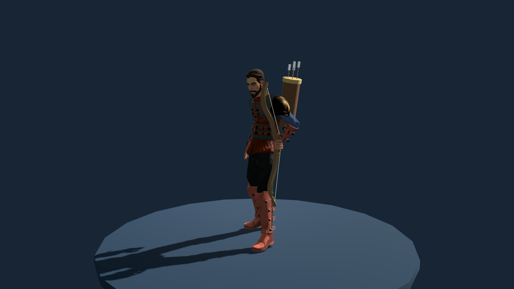
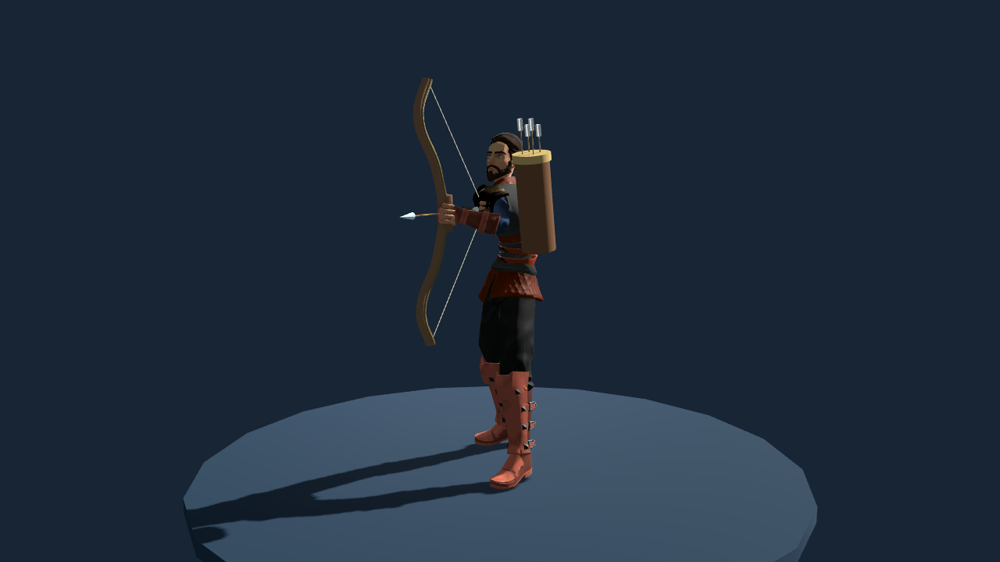
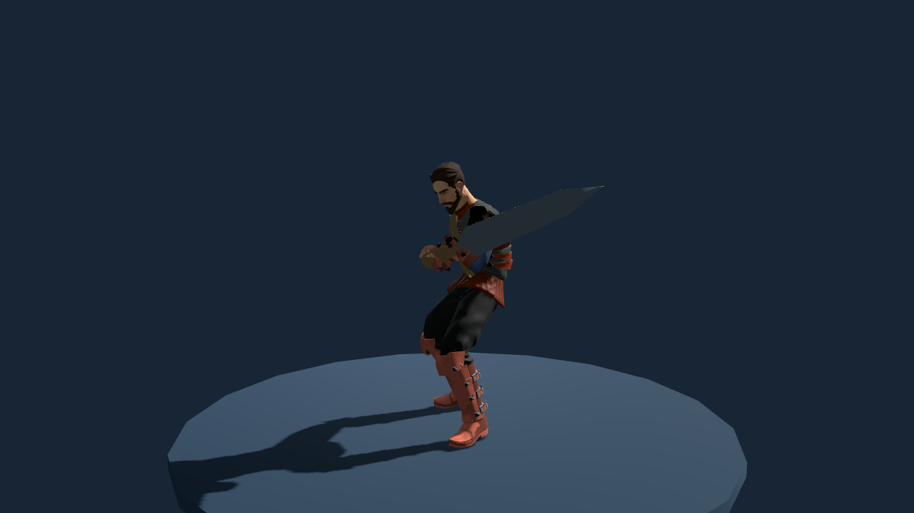
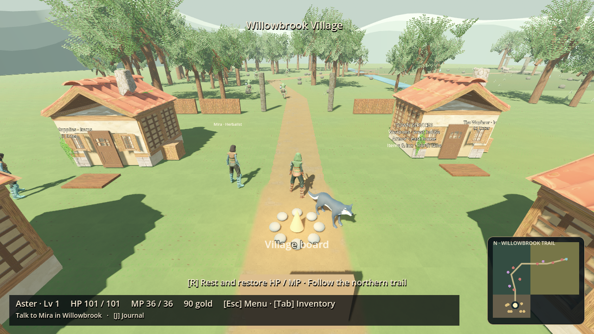
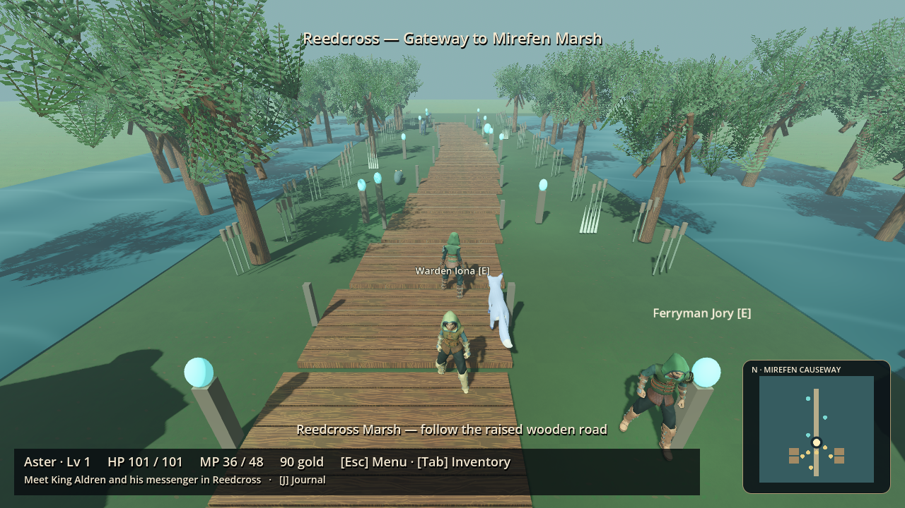

# Relaxed weapon stances and visible building entrances

This update adjusts presentation and town access. Classes, equipment rules, combat calculations, progression and save format are unchanged. Continue an existing adventure normally.

## Weapon holding

- **Bow:** relaxed one-hand carry at the side during idle, walking and running. The free arm retains the authored locomotion animation. The bow draws and nocks an arrow only during weapon attacks, then returns to carry; release and projectile visuals remain.
- **Two-handed weapons:** a diagonal guard across the body, with the lower hand near the hip and a separate upper grip. Polearms and staves use wider hand spacing. Attack poses blend from and back to this guard.
- **Regular sword:** attachment position and rotation are preserved exactly.

[Unchanged sword](screenshots/stances/sword_stance.png) · [Axe](screenshots/stances/axe_stance.png) · [Hammer](screenshots/stances/hammer_stance.png) · [Spear](screenshots/stances/spear_stance.png)

## Town entrances and camera

The cottage façades, doors, windows and shutters now face the default camera. All eight service entry points move with their visible doors. Nessa moves clear of Willowbrook’s armor entrance. Leaving a building resolves its current front door, including saves made inside before this update.

**Left/right arrows rotate; up/down arrows tilt.** Right-mouse drag remains available. Keyboard orbit works in Willowbrook, Mirefen, both dungeons and service interiors, and pauses behind their modal menus. WASD still moves the hero.

## Validation

Tested using Godot 4.6.3 on Linux. The gameplay suites and art lab total **2,008 passing assertions**, including 248 equipment/town checks and 75 art-lab checks. Checks cover both character sexes, idle/attack bow behavior, two-handed shaft orientation and grip spacing, the unchanged sword attachment, all service entries/exits, old indoor return positions, keyboard orbit, combat and save/load.

The legacy save round-trip fixture was corrected to use floating-point town coordinates, matching the loader’s deliberate position normalization. Production save code was not changed. The art lab’s historical hash exemptions explicitly include the requested camera/title changes; original baseline hashes remain preserved.

A separate copy imported successfully with no preexisting `.godot` cache and no asset-import or script errors. The sandbox denied the editor’s debugger-listener socket; this did not prevent import.

Actual OpenGL captures completed for 30 equipment/pose views and 11 world/interior views. The images above are from these runs. Some inherited native material diagnostics remain in headless presentation/character stress suites despite passing assertions; the rendering capture logs report no script or renderer errors.

## Scope and remaining limitations

Armor textures are deliberately unchanged for a later art pass. These are procedural arm-pose corrections applied to the existing authored character animation, rather than a new motion-captured animation pack. Weapon meshes and current outfit limitations remain as documented in the previous equipment report. These captures establish the revised guard and carry poses; they do not claim final animation polish for every attack.
