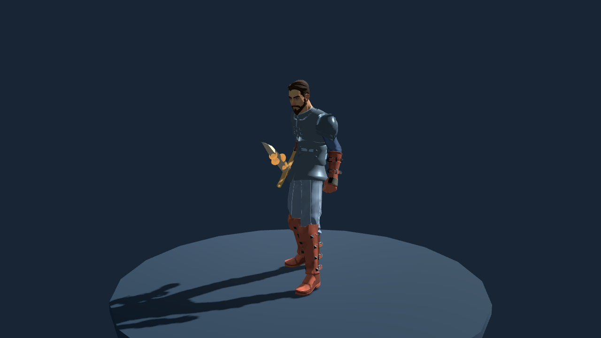
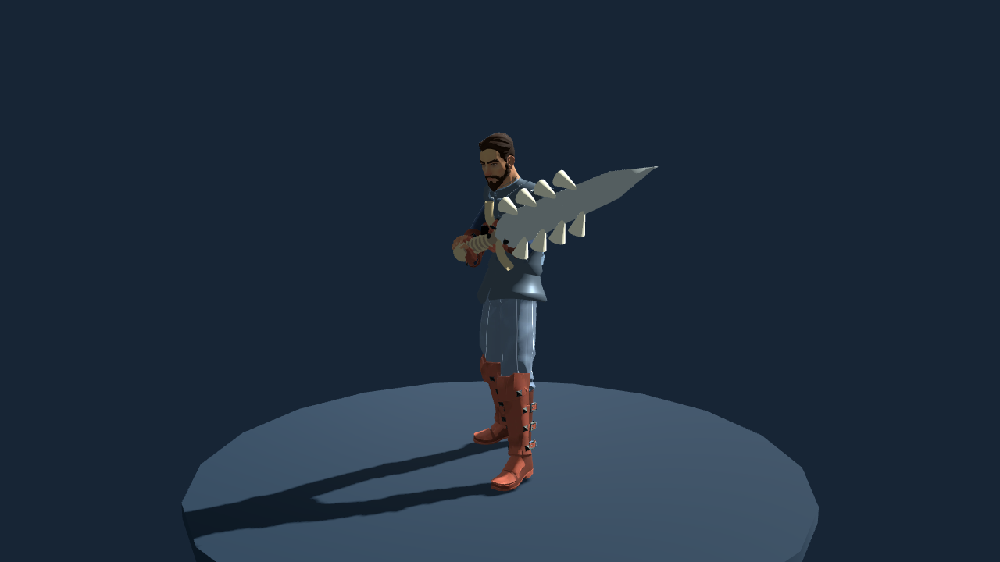
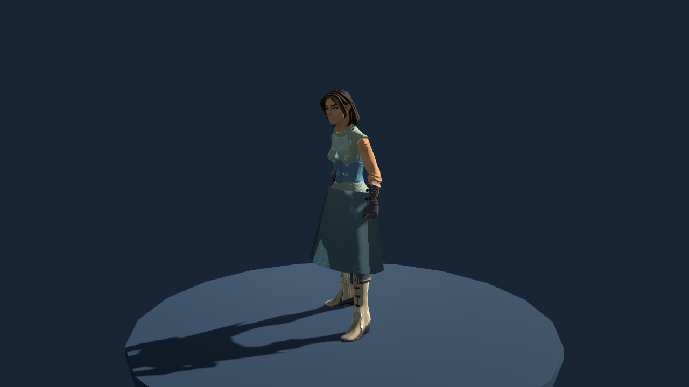
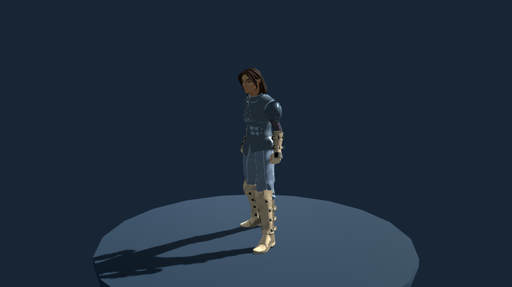
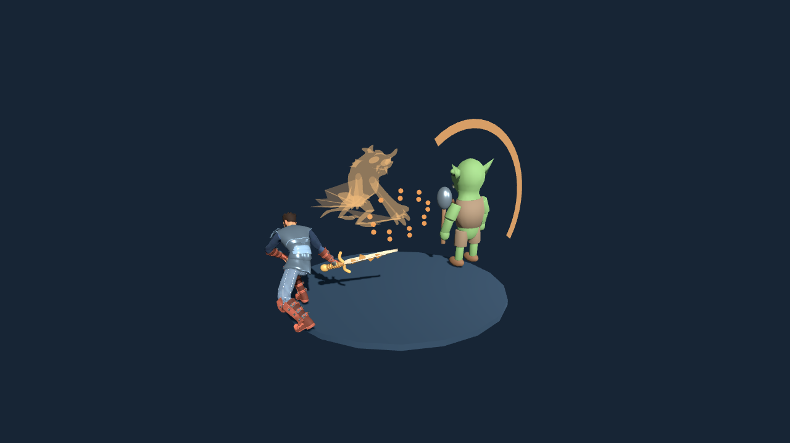
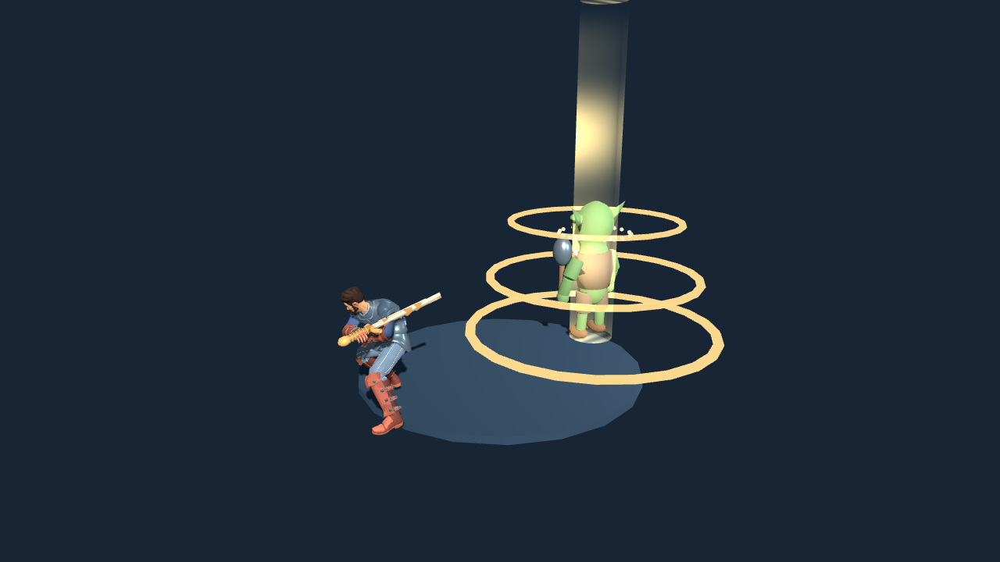
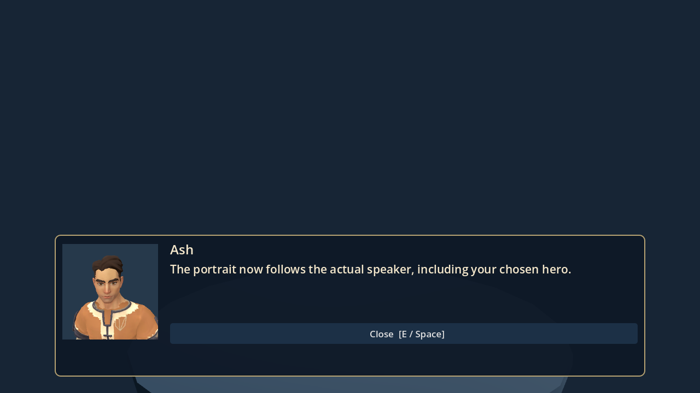
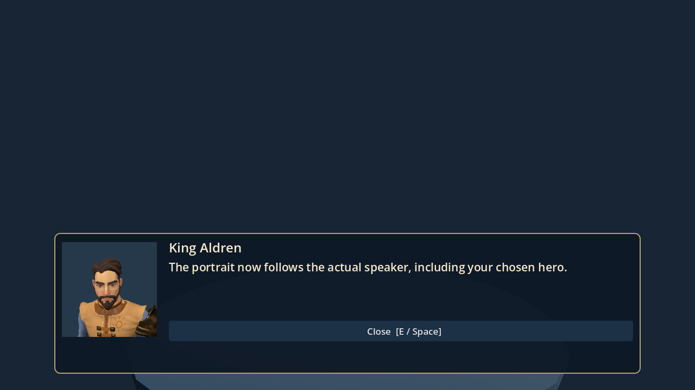
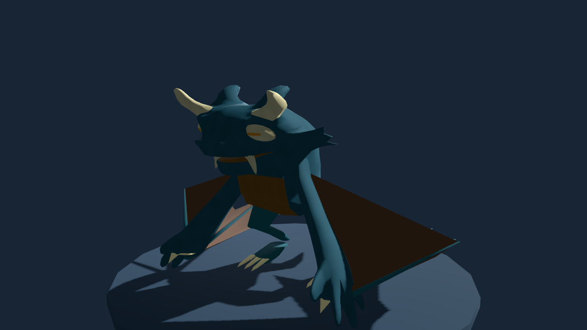
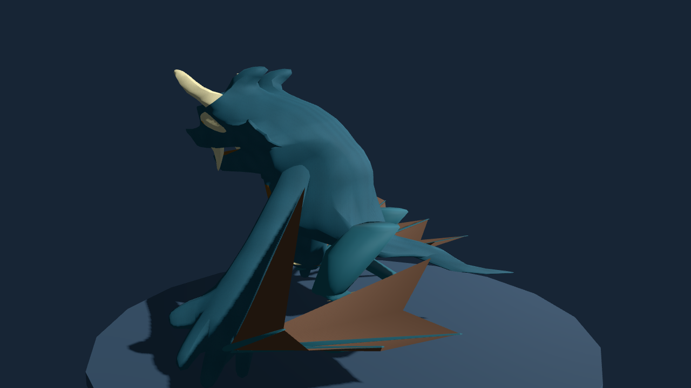

# Thematic gear, field powers and wing-arm dragons

This update preserves the four playable chapters, all twelve primary-class choices, any two secondary classes, male/female creation, quest state, existing equipment IDs, and the save location. Import the new project and choose **Continue adventure**. A new adventure is optional and gives the complete revised progression curve.

## Dungeon 4 crash investigation

The reported crash occurred during combat. Its exact Windows cause has **not** been reproduced. This update guards missing animation clips, defers dungeon scene transitions, prevents duplicate pending transitions, and propagates battle-speed settings into enemy animation adapters.

A stress scene exercises attacks, spells, companion actions and animated effects against all four Ironroot enemy types, followed by scene cleanup/return. It completed **40 animated rounds headlessly and another 40 with actual OpenGL rendering**, without script or renderer errors in those runs. This is evidence for those tested paths, not proof that every possible Windows crash is resolved.

The game now records a bounded local `user://journey-events.log` with region, enemy/action/effect names and timestamps. It contains no character name and is not uploaded automatically. If the crash repeats, preserve that file plus `user://logs/godot.log` and the Godot debugger error. On Windows, press Win+R, open `%APPDATA%\Godot\app_userdata`, then the `Verdant Oath — Prototype 0.1` folder. Keep your save files there intact.

## Equipment and shops

Willowbrook retains its simple starter equipment. **Reedcross stocks every weapon family**: sword, greatsword, axe, hammer, spear, bow, dagger, mace, staff, wand, claws and scythe. It also sells plate, robes, leathers, mantles, travel clothing, shields, helmets, gloves, leg armor, boots and accessories. Sahir and Kharholt add stronger, nonregional crafts rather than requiring early village-themed outfits. Older regional items remain valid in owned inventories and saves, but no longer dominate early shops.

Named gear includes Flamebrand, Dragonbone Greatsword, Stormcaller Spear, Moonstring Bow, Nightfang Daggers, Runekeeper Staff, Knight’s Harness, Runewoven Robe, Shadowstalker Leathers and Wildheart Mantle. Later crafts include Dawnforged Saber, Wyrmspine Greatblade, Astral Staff, Oathkeeper Plate and Aetherweave Robe.

These use distinct authored weapon-family foundations with original material treatments and blade/guard/rune/bone motifs. Clothing changes outfit family, textile patterns, color, skinned plate or robe/coat silhouette. Shop chest previews display the actual outfit on your current character. Original grip origins and two-handed/shield exclusions remain preserved.

Some weapons now deal an element on basic attacks: Flamebrand is fire, Stormcaller/Thunderhead lightning, Moonstring wind, Soulhook shadow, Dawnwatch holy, and Starseeker arcane. Explicitly typed techniques retain their own damage type. Inspect an item for its stats and element.

A mace skill tree and two mace techniques complete the previously missing weapon-tree coverage.

## Ability names and presentation

**Sundering Roar** is a weapon-independent spell using level-based sonic power and armor break. It costs 9 MP, has no HP cost, and is listed under Spells. Casting preserves a held weapon’s resting grip rather than swinging an axe. Weapon-contact techniques list their required families in both descriptions and battle tooltips.

Dragon Slash has a fiery sweep and a moving translucent dragon spirit. Sacred Strike uses a luminous energy column, descending light and halo layers. Roar projects expanding sound waves; Deathmark uses a distinct violet seal. Other elemental/multi-hit techniques gain layered effects matching their type or hit pattern, while retaining the existing authored animation library and weapon-family poses. These are expanded effect sequences, not a claim of a separately motion-captured clip for every skill.

## Consumables and travel

Open **Tab → Inventory** outside combat:

| Item | Effect |
|---|---|
| Return Thread | Exit the current dungeon at its outdoor entrance; no healing or boss credit |
| Town Waystone | Choose a story-discovered town, then teleport; cancel spends nothing |
| Camp Kit | Restore 30% maximum hero HP and MP |
| Royal Elixir | Fully restore hero HP and MP |

Healing potions, ethers and companion rations remain. In battle, the Items submenu now offers potions, ethers, elixirs and rations with real stock consumption. Auto-battle uses the same item rules and reports additional supplies spent. Travel consumables remain outside-combat tools.

## Companion progression and final field powers

A full companion tree now costs **80 BP**, with 2 BP per companion level. A newly selected companion starts at level 1 with 2 points. The next-level XP requirement is `240 + level × 120`, replacing the very fast old curve. Existing learned nodes and levels are retained; past cheap investments are grandfathered rather than erased.

Each final tree node unlocks a distinct field ability in **Inventory**:

| Companion | Final field power |
|---|---|
| Warhorse | Homeward Gallop: teleport to a discovered town |
| Griffin | Skyward Passage: fly to a landmark within the current outdoor region |
| Dragon | Emberglass Passage: escape the current dungeon |
| Golem | Heart of the Mountain: fully restore hero HP and MP |
| Spirit Fox | Moonlit Sanctuary: restore half hero HP/MP and revive or fully restore the fox, even if it was defeated |
| Dire Wolf | Trailwarden’s Instinct: reveal unopened treasure on the current area’s minimap until leaving |

Charges are recorded separately per companion and survive save/load. **Only a successful paid inn rest with that companion active recharges it.** Switching companions, potions, caches, camp restoration, travel or reloading do not recharge powers. Wolf reveal state persists when saving in the same area and clears on leaving it. Cancelling a travel picker does not spend the charge.

## Balance

Class growth and class-tree stat gains are reduced. Equipment gains above the basic tier are more restrained. Defense now uses diminishing returns: effective reduction is `DEF / (1 + DEF / 40)`, rounded before subtraction. This prevents moderate midgame armor from turning almost every incoming hit into 1 damage.

Auto-battle now evaluates elements, family bonuses, multiple hits, armor breaks, conditional damage and healing choices. It can spend ethers when MP is low. There is no guaranteed victory: preparation, investments, weapon selection, supplies and companion behavior matter.

All 24 sampled boss trials pass with level-8/12 builds, class-appropriate crafted equipment, modest real skill investments, an active dire wolf, eight potions and three ethers. Several builds spend most of those supplies. These trials are preparation examples, not a guarantee for every build/seed, and not a timed human balance playtest.

## Dialogue portraits

Dialogue renders the speaking character’s head/shoulders in its own viewport. Your hero uses your actual sex, appearance, primary-class look and equipment. Story NPCs use the same class/body definitions as their world actors; guardians show their own creature models. No generic woman SVG is substituted for the cast.

## Four-limbed dragons

The companion dragon and Namarra now use **two hind legs plus two integrated supporting wing-arms**. Wing wrists carry claws; membranes and elongated fingers share the arm chain. The separate old back-wing chain is removed. Ground idle/walk/run use the legs and wing-arms; flight, attack, support, guard, hit and death clips are included. Sandglass Drakes retain the older legless source anatomy.

This is an original, stylized derivative of the existing licensed Quaternius dragon head/body/materials, with new anatomy, rigging and motion. It is not an extracted television/game model or a newly downloaded commercial asset. The remaining cute proportions and prototype animation polish are visible in the review captures.

## Validation and remaining limits

Tested in Godot **4.6.3 on Linux**, with **2,810 passing assertions** across the gameplay, progression, shop, visual-preservation, art-lab, frontier, balance, new-feature and animated combat suites. Repeated rendered combat is counted once in that assertion total. The new-feature suite checks every weapon family’s shop coverage, named motifs, both body types, travel spending, all six field powers, inn recharge, portrait identities, dragon bones/clips, separate drakes, save/load and repeated dungeon-four mechanism use.

A separate copy imported without a preexisting `.godot` cache and passed its 139 new-feature assertions. The sandbox denied the editor debugger-listener socket during import; asset/script import completed. Thirty rendered captures cover equipment, portraits, dragon poses and named effects. Some inherited native `material is null` diagnostics remain in headless presentation stress tests despite passing assertions; the rendered review and combat-stress logs reported no script/renderer errors.

Historical visual-only hash exemptions explicitly include the requested gameplay, inventory, portrait and preview revisions; original baseline files remain unchanged. No third-party asset pack was downloaded. Pattern and dragon derivative provenance is recorded beside the assets, with reproducible Blender/Python tools.

The exact reported Windows crash remains unconfirmed, Windows 4.7 rendering has not been tested here, and some armor/weapon families share foundations rather than bespoke sculpted models for every item. Further art/animation refinement and a human difficulty playtest remain appropriate.
